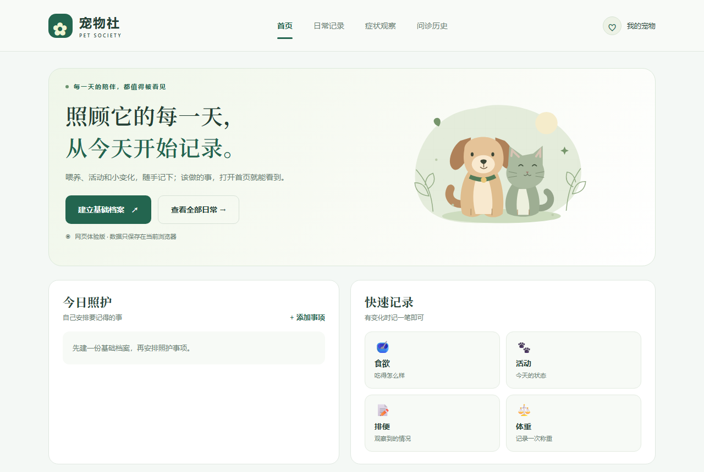
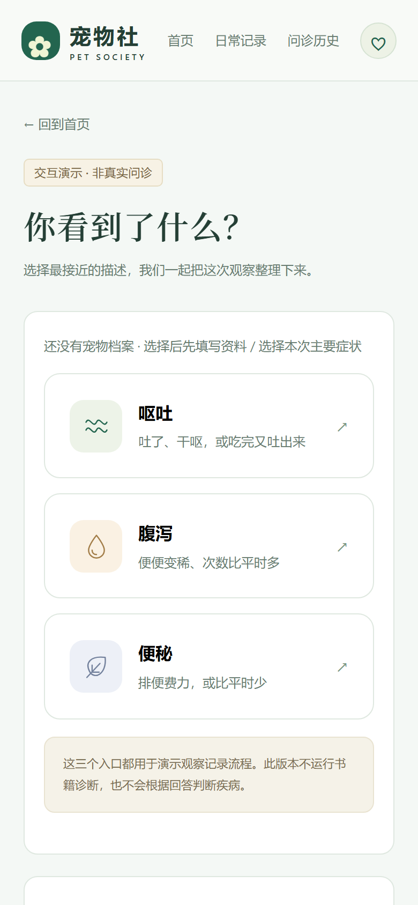

# 宠物社 · 网页体验版

**记录宠物的日常照护，把小变化整理成看得懂的观察摘要。**

[](https://xiaotian69.github.io/pet-society-preview/)


> Pet Society web preview: a static, interactive demo for daily pet-care logging and a symptom-observation flow. **No AI is connected** — it does not diagnose, prescribe, or call any model API.

**[打开在线体验 →](https://xiaotian69.github.io/pet-society-preview/)** 手机和电脑都能直接打开，无需注册，资料只保存在当前浏览器。



> ⚠️ **这是交互式网页演示，不是兽医诊断工具。** AI 尚未接入；症状入口只生成观察摘要，疾病与治疗页是明确标注的占位布局，不显示诊断、处方或任何书籍证据。宠物身体异常请及时咨询执业兽医。

## 项目定位

宠物社最初是一个微信小程序，这个仓库是沿用其浅绿风格的**独立网页体验版**，用来演示两条核心流程：

1. **日常照护记录**：建立基础档案，随手记录食欲、活动、排便和体重，安排并勾选照护事项。
2. **症状观察流程**：选择症状 → 三轮观察问答 → 生成观察摘要并保存到历史。

## 能体验什么

| 模块 | 当前实现 |
| --- | --- |
| 日常首页 | 今日照护事项与快速记录入口 |
| 基础档案 | 必填基本信息、选填照护信息；当前只支持同一只宠物的资料修正 |
| 快捷记录 | 食欲、活动、排便、体重四类记录 |
| 照护事项 | 用户自填日期，可在首页或历史页标记完成；只在打开网页时显示，不发送系统通知 |
| 日常历史 | 浏览日常记录，最多保留最近 500 条 |
| 症状观察 | 呕吐、腹泻、便秘三个入口共用同一套三轮观察流程，结果为观察摘要 |
| 问诊演示历史 | 保存、重新打开、删除摘要，最多 50 条 |
| 疾病 / 治疗详情 | 占位布局，明确标注未接入 AI |

共 12 个 hash 路由页面：日常首页、基础档案、快捷记录、照护事项、日常历史、宠物资料、症状选择、三轮观察、观察结果、疾病详情、治疗详情、问诊演示历史。

<p align="center">
  
</p>

## 数据与隐私

- 不登录、不上传，所有记录保存在当前浏览器的 `localStorage`。
- 浏览器存储不可用时，降级为当前页面会话保存并明确提示。
- 页面提供「删除本机演示资料与记录」入口；更换浏览器或设备不会同步数据。
- 仓库只包含网页预览，不含原始书籍、知识库、后端环境文件或真实宠物资料。

## 本地运行

项目是纯静态页面（原生 HTML / CSS / ES Modules），无需构建：

```bash
git clone https://github.com/Xiaotian69/pet-society-preview.git
cd pet-society-preview
python -m http.server 5173 --bind 127.0.0.1
```

打开 `http://127.0.0.1:5173/`。请通过 HTTP 服务访问，直接双击 `index.html` 会被浏览器阻止加载 ES Module。

## 测试

```bash
npm ci
npm test                         # Node 内置测试：记录模型与日常数据
npx playwright install chromium
npm run test:browser             # 手机/桌面布局、全部路由、存储与刷新
```

浏览器测试会启动仅监听本机的临时静态服务，截图写入已被忽略的 `qa/` 目录。

## 部署

GitHub Pages：Deploy from a branch → `main` → `/ (root)`。静态资源使用相对路径，页面使用 hash 路由，可在仓库子目录下直接刷新。

## 后续规划（尚未实现）

- 接入 AI 时，问诊操作将放入独立 API 模块，调用部署在 HTTPS 服务器上的后端，并恢复后端要求的完整入诊资料。
- 模型密钥只存服务器环境变量，不写入静态网页或 GitHub 仓库。
- 演示资料与真实问诊记录将使用不同的存储命名空间。

以上为规划方向，不代表已有功能或确定的发布时间。

## 项目结构

```text
.
├── index.html     # 页面骨架
├── app.mjs        # 路由与页面渲染
├── model.mjs      # 观察流程与问诊演示历史
├── daily.mjs      # 日常记录与照护事项
├── styles.css     # 浅绿主题与响应式布局
├── tests/         # Node 单元测试与 Playwright 浏览器检查
└── docs/          # 设计说明与 README 截图
```
